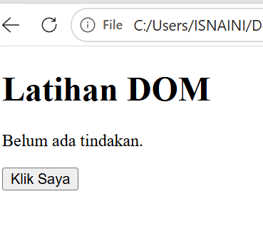
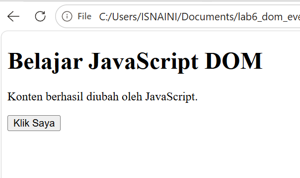
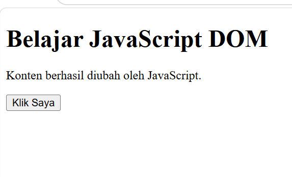
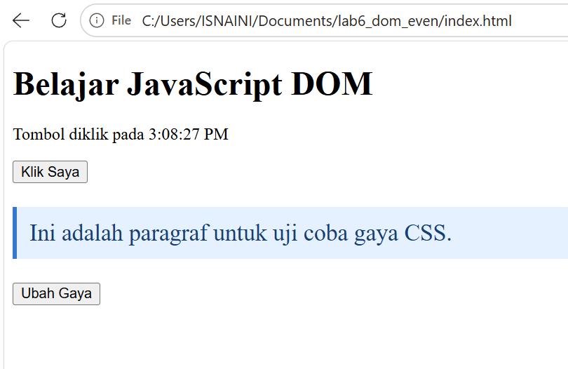
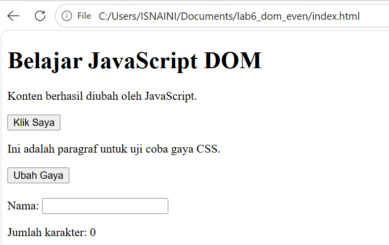
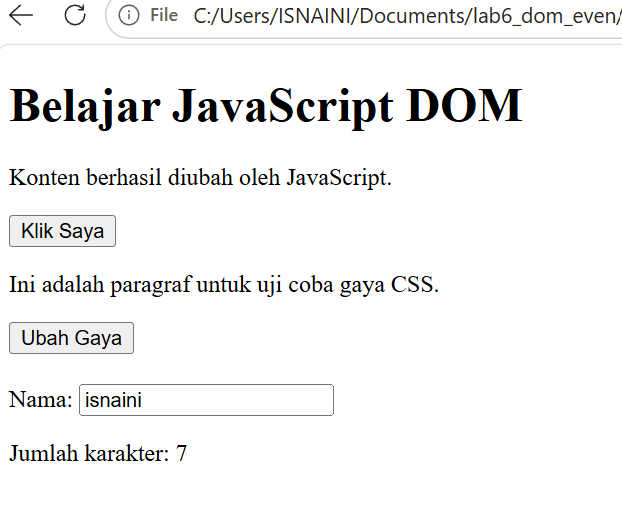

# Lab6Web

# Complete Web Programming Practicum (Lab 1 - Lab 6)

Repositori ini berisi seluruh modul praktikum, dokumentasi laporan, serta eksperimen interaktif untuk mata kuliah Pemrograman Web, mencakup modul dasar hingga pengembangan logika interaktif menggunakan JavaScript.

## Identitas Praktikan
- **Nama:** Isnaini
- **Mata Kuliah:** Pemrograman Web
- **Cakupan Modul:** Lab 1 sampai Lab 6 beserta Eksperimen 1 - 5

---

## Daftar Modul & Hasil Praktikum

### Lab 1: Dasar HTML5
- Pengenalan struktur dokumen HTML standar.
- Penggunaan tag heading, paragraf, daftar berurutan dan tidak berurutan, serta penyisipan tautan dan gambar.
- **Hasil Lab 1:**
  
  
  
  

### Lab 2: Form & Tabel HTML
- Pembuatan struktur tabel data secara terstruktur.
- Penyusunan elemen formulir interaktif menggunakan berbagai jenis input, pilihan dropdown, dan tombol aksi.
- **Hasil Lab 2:**
  
  
  
  

### Lab 3: Dasar CSS3 & Stylings
- Penerapan gaya tampilan menggunakan Inline, Internal, dan External CSS.
- Penggunaan selektor elemen, kelas, ID, serta pengaturan Box Model (margin, padding, border).
- **Hasil Lab 3:**
  

### Lab 4: Responsive Web Design (Flexbox & Grid)
- Pengaturan tata letak modern menggunakan CSS Flexbox dan CSS Grid.
- Pembuatan desain web responsif yang menyesuaikan ukuran layar menggunakan Media Queries.
- **Hasil Lab 4:**
  

### Lab 5: Dasar Pemrograman JavaScript ES6
- Pengenalan logika pemrograman JavaScript berbasis client-side.
- Penggunaan variabel modern, fungsi (arrow function), struktur pengkondisian, dan perulangan.
- **Hasil Lab 5:**
  

### Lab 6: DOM Manipulation & Eksperimen 1 - 5
1. **Eksperimen 1: To-Do List** – Fitur tambah dan hapus item tugas secara dinamis menggunakan manipulasi DOM.
   - *Screenshot:* 
2. **Eksperimen 2: Validasi Form Nama** – Pengecekan input client-side minimal 3 karakter dengan pesan notifikasi error/sukses.
   - *Screenshot:* 
3. **Eksperimen 3: Dropdown Event Change** – Merespons perubahan opsi elemen select secara real-time.
   - *Screenshot:* 
4. **Eksperimen 4: Toggle Paragraf** – Menyembunyikan dan menampilkan elemen paragraf melalui manipulasi kelas CSS.
   - *Screenshot:* 
5. **Eksperimen 5: Analisis Penempatan Script** – Studi kasus pemuatan DOM, penempatan tag script, dan penggunaan event DOMContentLoaded.
   - *Screenshot:* 

---

## Cara Menjalankan Proyek
1. Unduh atau salin seluruh file proyek ke dalam direktori komputer lokal.
2. Pastikan file utama tersusun rapi di dalam folder.
3. Jalankan file dengan membukanya langsung di browser web (Google Chrome atau Microsoft Edge).

---

## Dokumentasi Laporan
Laporan praktikum lengkap yang membahas Bab I Pendahuluan, Bab II Dasar Teori, Bab III Pembahasan Lab 1 sampai Lab 6, serta Bab IV Kesimpulan dan Saran telah disusun dalam format dokumen teks dan siap digunakan untuk melengkapi tugas akademik.
